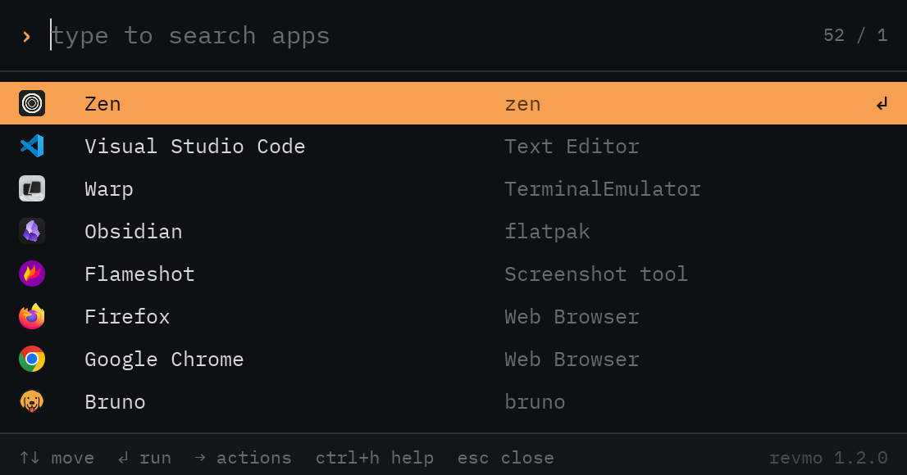
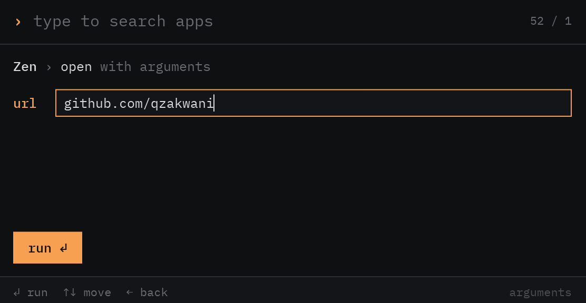

<div align="center">


# revmo

**Every app on your computer, a few keystrokes away.**

[](https://github.com/qzakwani/revmo/releases/latest)




</div>

Revmo is an app launcher for Linux. Hit your shortcut, type a few letters
of what you want, press Enter. No menus to dig through, no mouse needed.

## Features

- **Fuzzy search**: `lw` finds LibreOffice Writer; descriptions and keywords are searched too.
- **Learns your habits**: apps you launch often and recently come first.
- **Actions, files and links**: run an app's actions (e.g. *New Private Window*), or open files and URLs with it.
- **Themes**: 24 to pick from (Catppuccin, Dracula, Gruvbox, Nord, Tokyo Night, …), or make your own.
- **Your app list**: hide the apps and actions you never use.
- **X11 and Wayland**.

## Install

You need 64-bit (x86_64) Linux on a glibc-based distribution (most are;
Alpine isn't), and `curl` and `sha256sum`.

```sh
curl -fsSL https://raw.githubusercontent.com/qzakwani/revmo/main/scripts/install.sh | sh
```

This installs `revmo` to `~/.local/bin`, adds it to your application menu
and writes a starter config to `~/.config/revmo/config` (if you don't have
one yet).

**To update**, run the same command again. Your config, your own themes
and your launch history are kept.

**To uninstall**:

```sh
curl -fsSL https://raw.githubusercontent.com/qzakwani/revmo/main/scripts/uninstall.sh | sh
```

> [!WARNING]
> Uninstalling removes everything, including your config and your own
> themes in `~/.config/revmo`. Copy them somewhere first if you want to
> keep them.

## ⌨️ Bind it to a shortcut

> [!IMPORTANT]
> **This is how Revmo is meant to be used.** Bind `revmo` to a key
> combination and it's one keypress away from anywhere. Press it again
> (or `Esc`, or click outside the window) to close it.

Pick any free combination; `Super + Space`, `Super + D` and `Alt + Space`
are popular. Use the command `revmo`, or the full path
`/home/<you>/.local/bin/revmo` if the shortcut doesn't work with just the
name.

<details>
<summary><b>GNOME</b></summary>

Settings → Keyboard → View and Customize Shortcuts → Custom Shortcuts →
**+**. Name it `Revmo`, set the command to `revmo` and press your keys.

</details>

<details>
<summary><b>KDE Plasma</b></summary>

System Settings → Keyboard → Shortcuts → Add New → Command or Script.
Enter `revmo`, then set the shortcut.

</details>

<details>
<summary><b>Cinnamon</b></summary>

System Settings → Keyboard → Shortcuts → Add custom shortcut. Set the
command to `revmo`, then click the empty binding and press your keys.

</details>

<details>
<summary><b>Hyprland</b></summary>

In `~/.config/hypr/hyprland.conf`:

```ini
bind = SUPER, SPACE, exec, revmo
```

</details>

<details>
<summary><b>Sway / i3</b></summary>

In your config:

```
bindsym $mod+space exec revmo
```

</details>

You can also open Revmo from your application menu or by running `revmo`
in a terminal. Press `Ctrl + H` inside it for the keys.

## Commands

| Command | What it does |
|---|---|
| `revmo` | Open Revmo (or close it if it's open) |
| `revmo list-apps` | List apps and their actions, with the IDs `Hidden=` takes |
| `revmo list-fonts` | List installed font families, as `Font=` takes them |
| `revmo --help` | Show the commands |
| `revmo --version` | Show the version |

## Configuration

Settings live in `~/.config/revmo/config`. The installer writes this one
for you; every setting is commented out, so the defaults apply until you
remove a `#`:

```ini
# Revmo settings. Every setting is optional: remove the # to use one.
[Revmo]

# Color theme; Ctrl+Left / Ctrl+Right also changes it.
# Theme=Revmo Dark

# Font family name; run `revmo list-fonts` to see them. Monospaced ones
# (marked mono) suit revmo best.
# Font=

# UI size, e.g. 1.5; empty or auto picks one from your monitor.
# Scale=

# Apps and actions to leave out, separated by ;
# Run `revmo list-apps` to see their IDs (the last column).
# Hidden=
```

Changes apply the next time you open Revmo.

Revmo only ever changes the `Theme=` line (when you switch theme with
`Ctrl + ←` / `Ctrl + →`) and leaves the rest as you wrote it, so the file
is safe to keep with your dotfiles. If a line has a mistake, Revmo uses
the default for that setting and tells you; `Ctrl + H` lists every
problem.

<details>
<summary><b>Hiding apps</b></summary>

Find the app's ID with `revmo list-apps`, then add it to `Hidden=`:

```console
$ revmo list-apps | grep -i logs
Logs                  org.gnome.Logs.desktop
```

```ini
Hidden=org.gnome.Logs.desktop;nm-connection-editor.desktop;
```

Hiding an app hides its actions too. To hide a single action, use its ID
(e.g. `firefox.desktop/new-private-window`). `revmo list-apps` marks
what's hidden, so you can find what to remove to bring something back.

</details>

<details>
<summary><b>Scale</b></summary>

On Wayland, Revmo follows your desktop's scaling. On X11, an empty
`Scale=` works one out from your primary monitor's size. If it comes out
too small or too large (for example with several monitors), set it
yourself, e.g. `Scale=1.5`. `Ctrl + H` shows the scale in use.

</details>

## Themes

Switch themes with `Ctrl + ←` / `Ctrl + →`; the one you land on is saved.

To make your own, save this as `~/.config/revmo/themes/<name>.theme` and
reopen Revmo. `Background`, `Text` and `Accent` are all you
need; the other colors are optional and worked out from those three when
left out. The values shown are what Revmo works out for this example;
remove a `#` to set one yourself.

```ini
[Theme]
# Shown in Revmo and used by Theme= in the config; the file name if left out.
Name=Mine

# Required.
Background=#1d2021
Text=#ebdbb2
Accent=#b8bb26

# Optional.
# Footer and input fields.
# Raised=#232625
# The highlighted row while the actions pane is open.
# SelectedSoft=#2b2d2b
# The window's outer border.
# Frame=#3a3a35
# Dividers between sections.
# Border=#3a3a35
# BorderStrong=#48473f
# Secondary text, from most to least visible.
# TextDim=#ada387
# TextMuted=#88816c
# TextFaint=#676355
# Text on the accent color.
# OnAccent=#1d2021
# The selected row, and the text on it.
# Selection=#b8bb26
# OnSelection=#1d2021
# Errors and confirmations.
# Danger=#e07b6a
# Success=#8fbf6a
# Matched letters in search results.
# Highlight=#b8bb26
```

Colors are `#rrggbb`, or `#rrggbbaa` with transparency. Your theme
replaces a bundled one with the same name, except Revmo Dark and Revmo
Light.

## Troubleshooting

**`revmo: command not found`**: `~/.local/bin` isn't in your `PATH`. Add
`export PATH="$PATH:$HOME/.local/bin"` to your shell's config (e.g.
`~/.bashrc`), or run `~/.local/bin/revmo`.

**The shortcut does nothing**: your desktop may not find `revmo` by name.
Use the full path in the shortcut, e.g. `/home/<you>/.local/bin/revmo`.

**A newly installed app or a new icon theme doesn't show up**: Revmo
picks up new and removed apps and icon theme changes each time it opens,
a moment after the window appears. Close it and open it again.

**Terminal apps (Vim, htop, …) don't open**: Revmo didn't find a terminal
to run them in. Set `TERMINAL` (e.g. `export TERMINAL=kitty`) or install
one of kitty, foot, alacritty, wezterm, ghostty, gnome-terminal, konsole,
xfce4-terminal, tilix or xterm.

Something else? [Open an issue](https://github.com/qzakwani/revmo/issues).

## Building from source

Needs Rust 1.99 or newer.

```sh
cargo build --release
./target/release/revmo
```

## Credits

Revmo ships with the [IBM Plex Mono](https://github.com/IBM/plex) font.
The bundled themes are ports of their authors' color schemes.
